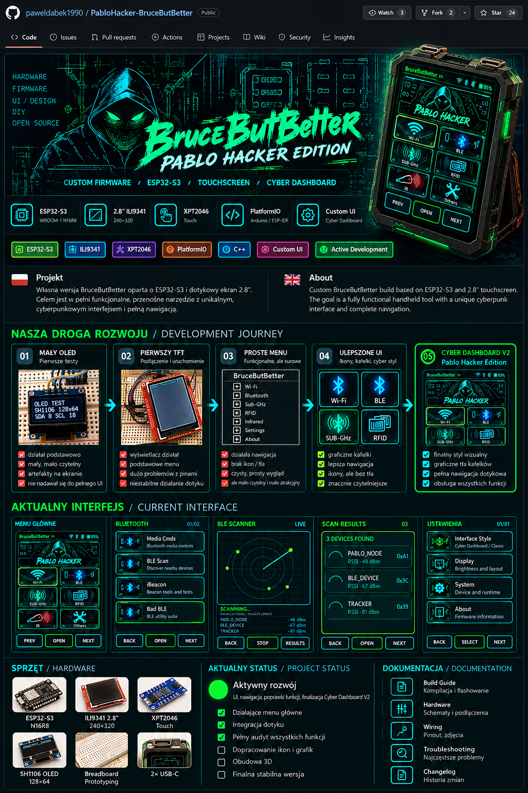
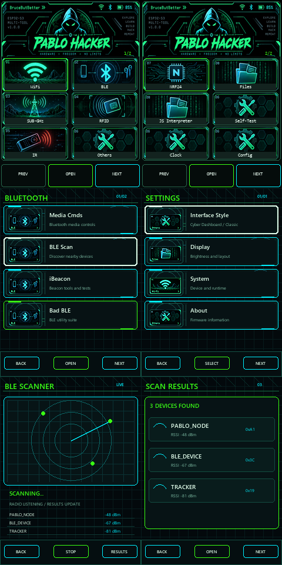
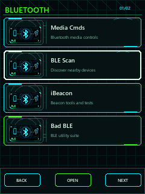
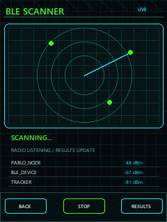
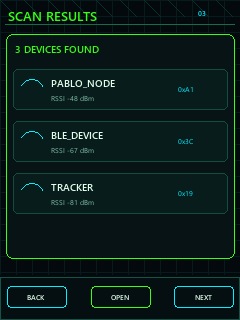
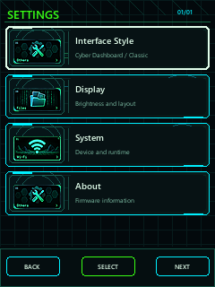
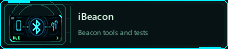

> **Branding transition / Zmiana nazwy:** Dolphin One (D1) is the new project name. The historical artwork above still contains the old logo and will be replaced, not falsely presented as the new brand.

<a href="README_PL.md">🇵🇱 Polski</a> · <a href="README.md">🇬🇧 English</a>

# BruceButBetter / Dolphin One

**Cyber Dashboard V2** · ESP32-S3-WROOM-1 N16R8 · ILI9341 240×320 · XPT2046

   

> A real hardware and interface development log, from a small SH1106 OLED experiment to the Dolphin One touchscreen direction. The artwork is preserved as artwork; it is not presented as proof of a finished enclosure or completed hardware.

## Our development journey

The five stages below describe the progression without inventing historical photographs. Only assets with known provenance are presented as project exports.

| 1 · SH1106 OLED | 2 · First ILI9341 | 3 · Raw menu | 4 · Improved tiles | 5 · Cyber Dashboard V2 |
|---|---|---|---|---|
| First prototype, small screen, visible artefacts and hard limits. | Wiring and driver experiments around the 240×320 TFT. | Working foundations, clipped elements and navigation bugs. | Layout and illustration work moved toward readable touch tiles. | Approved visual direction; integration and testing remain in progress. |

## Current interface · authentic 240×320 exports

<table>
<tr><td align="center"><strong>Main Menu</strong> </td><td align="center"><strong>Bluetooth</strong> </td><td align="center"><strong>BLE Scanner</strong> </td></tr>
<tr><td align="center"><strong>Scan Results</strong> </td><td align="center"><strong>Settings</strong> </td><td align="center"><strong>BLE / iBeacon cards</strong>  </td></tr>
</table>

## Hardware & documentation

| Component | Current project definition |
|---|---|
| Controller | ESP32-S3-WROOM-1 N16R8 · 16 MB Flash · 8 MB PSRAM |
| Display | ILI9341 240×320 |
| Touch | XPT2046 resistive touch controller |
| Build | PlatformIO environment `esp32-s3-n16r8-ili9341-touch` |
| Wiring | [GPIO and hardware wiring](HARDWARE_WIRING.md) |

**Confirmed project state:** the display bring-up, touch path on tested screens, and firmware build/flash workflow are documented. Full menu flow, BLE Back behavior, submenu behavior, visual consistency and final physical acceptance testing are still under development. No finished 3D enclosure or fictional test result is claimed here.

## Next steps

- complete and verify the remaining menu/navigation paths;
- continue hardware integration and physical acceptance tests;
- keep the 240×320 exports and provenance notes synchronized with the implementation;
- document changes in the [changelog](CHANGELOG.md).

## Documentation

[Build Guide](docs/software/build.md) · [Diagnostics](DIAGNOSTYKA.md) · [Known Issues](KNOWN_ISSUES.md) · [Changelog](CHANGELOG.md) · [Asset Manifest](docs/showcase/ASSET_MANIFEST.md)

Unofficial variant of <a href="https://github.com/Yoursel71/BruceButBetter">BruceButBetter</a>. Original authorship, attribution and <a href="LICENSE">license</a> are retained. Security features are for authorized testing and education.
