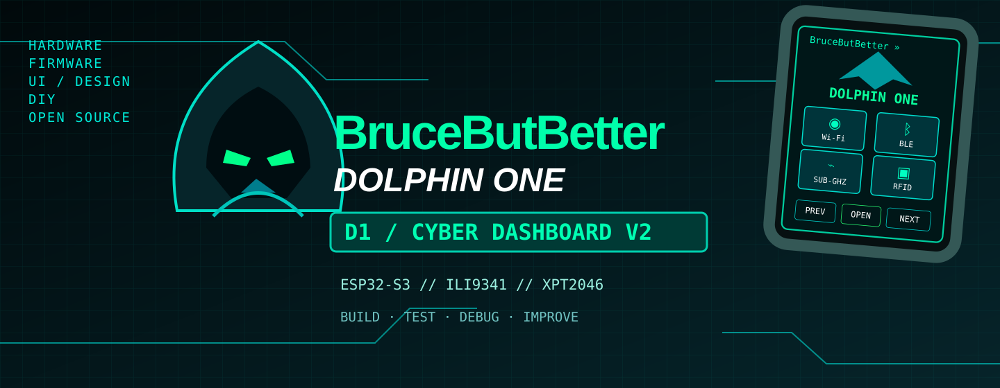
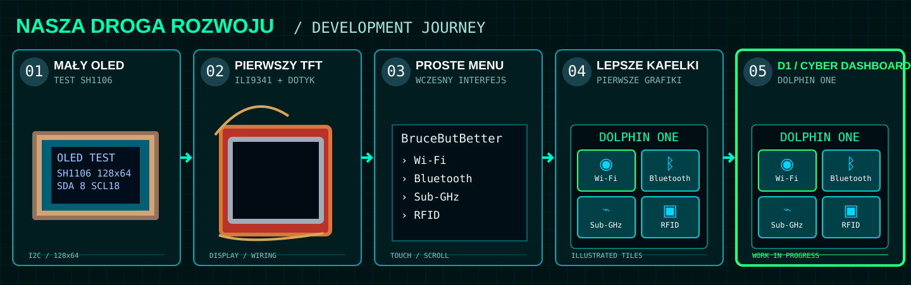
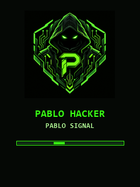

<a href="README_PL.md">🇵🇱 Polski</a> · <a href="README.md">🇬🇧 English</a>

# BruceButBetter / Pablo Hacker Edition

**Cyber Dashboard V2** · ESP32-S3-WROOM-1 N16R8 · ILI9341 240×320 · XPT2046

  

> **Od maleńkiego OLED-a do własnego urządzenia z dotykowym ekranem.** To nieoficjalny wariant BruceButBetter i zapis faktycznych prób z elektroniką, firmware i interfejsem. Wizualizacje koncepcyjne nie są przedstawiane jako zdjęcia działającego sprzętu.

## Nasza droga: pięć etapów

**Archiwum zdjęć jest kompletowane:** prawdziwa fotografia OLED-a → pierwszy TFT na płytce stykowej → ucięte menu → pierwsze kafelki → zaakceptowane projekty V2. Nie oznaczamy rekonstrukcji jako autentycznych zdjęć. [Wykaz i pochodzenie obrazów](docs/showcase/ASSET_MANIFEST.md).

## Cyber Dashboard V2 — styl interfejsu

<table><tr><td width="35%"></td><td><strong>Grafika nie zamiast funkcjonalności, tylko obok niej.</strong>
Ilustrowane Wi-Fi, BLE, Sub-GHz, RFID, IR i pozostałe kafelki, zaprojektowane specjalnie pod dotykowy ekran 240×320. Zaakceptowane referencje obejmują też Bluetooth, skaner BLE, wyniki skanowania i ustawienia.

<em>Po lewej: starszy podgląd splash screenu, nie zdjęcie ukończonego V2.</em>
</td></tr></table>

Oryginalne eksporty 240×320 przesłane przez właściciela projektu mają trafić do `docs/showcase/screens/`. **Nie podmieniamy ich na wymyślone zrzuty.**

## Sprzęt i stan projektu

| Podzespół | Konfiguracja |
|---|---|
| Mikrokontroler | ESP32-S3-WROOM-1 N16R8, 16 MB Flash, 8 MB PSRAM |
| Wyświetlacz | TPM408-2.8 / ILI9341 240×320 |
| Dotyk | Rezystancyjny XPT2046 |
| Środowisko | `esp32-s3-n16r8-ili9341-touch` |
| Dawny prototyp | OLED SH1106 128×64 — etap historyczny, później zwrócony |

**Potwierdzone:** uruchomienie wyświetlacza, ścieżka dotyku w testowanych ekranach, kompilacja i flashowanie. **W trakcie:** pełna nawigacja, powrót BLE, działanie podmenu, grafiki i fizyczne testy końcowe. Obecność funkcji w kodzie nie gwarantuje, że odpowiedni moduł jest podłączony.

## Dokumentacja

[Połączenia](HARDWARE_WIRING.md) · [Kompilacja](docs/software/build.md) · [Diagnostyka](DIAGNOSTYKA.md) · [Błędy](KNOWN_ISSUES.md) · [Historia zmian](CHANGELOG.md) · [Mapa grafik](docs/showcase/ASSET_MANIFEST.md)

Nieoficjalny wariant [BruceButBetter](https://github.com/Yoursel71/BruceButBetter). Zachowano atrybucję twórców i [licencję](LICENSE). Funkcje bezpieczeństwa wyłącznie do autoryzowanych testów i nauki.
