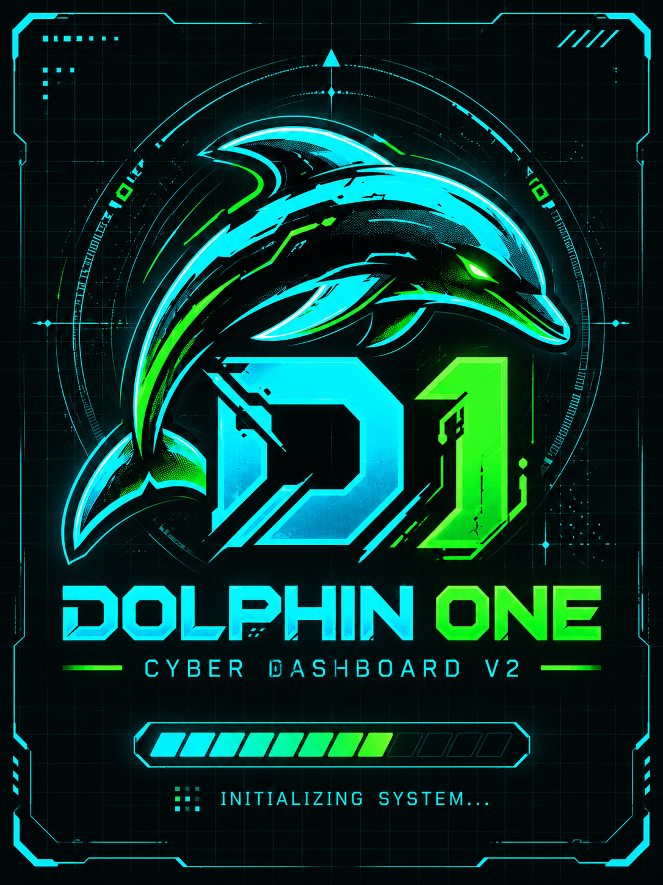

# Dolphin One (D1)
ESP32-S3 N16R8 • ILI9341 240×320 • XPT2046 • projekt oparty na BruceButBetter

[English](README.md) · [Stan projektu](docs/software/PROJECT_STATE.md) · [Kod i funkcje](docs/software/CODE_MAP.md) · [Budowanie](docs/software/build.md)

## Referencja wizualna


To istniejąca referencja brandingu Dolphin One D2, przeniesiona z gałęzi dokumentacyjnej. Jest grafiką projektową, nie zdjęciem ani potwierdzonym zrzutem działającego firmware. Skrót produktu to D1; D2 w nazwie pliku oznacza referencję, nie drugi model sprzętu. Późniejsze referencje menu V8 nie są dostępne w tej kopii.

## Co faktycznie mamy
Kod firmware na tej publicznej gałęzi pozostaje historyczną bazą sprzętową z 9 października 2026. Dokumentację uzgodniono 17 października 2026. **Nie jest to wydanie późniejszego firmware D1 wgranego lokalnie.** Kod nadal zawiera historyczny branding.

W toku projektu sprawdzano wyświetlacz, dotyk oraz nawigację menu/Wi-Fi. Nie potwierdza to wszystkich ścieżek menu na obecnym urządzeniu. Dokładne powiązanie lokalnych źródeł D1 z plikiem firmware wymaga importu.

| Funkcja | Status dla tej konfiguracji |
|---|---|
| ILI9341 / XPT2046 | Skonfigurowane; historycznie sprawdzane |
| Wi-Fi / BLE | Kod obecny; pełne testy fizyczne pozostają do wykonania |
| USB/HID | Włączone w konfiguracji; odbiór fizyczny niepotwierdzony |
| RFID/NFC, Sub-GHz, NRF24, IR | Kod/konfiguracja obecne; wymagają zgodnych modułów i testów |
| SD / pliki | Kod obecny; w historii zgłaszano problemy montowania SD |
| LoRa / GPS / Ethernet / FM | Wyłączone flagami tego środowiska |

[Mapa kodu](docs/software/CODE_MAP.md) wskazuje pliki i ograniczenia weryfikacji.

## Sprzęt i budowanie
16 MB flash, 8 MB PSRAM. Wspólne SPI: MOSI 11, SCK 12, MISO 13. TFT CS 15, DC 17, RESET 16; touch CS 10; SD CS 14 (niezweryfikowane).

```powershell
pio run -e esp32-s3-n16r8-ili9341-touch
```

[Połączenia](HARDWARE_WIRING.md) · [Budowanie i flashowanie](docs/software/build.md) · [Dowody fizycznych połączeń](docs/hardware/AS_BUILT/VERIFICATION_REPORT.md)

## Dokumentacja
- [Stan projektu, pochodzenie danych i lokalne pliki do odzyskania](docs/software/PROJECT_STATE.md)
- [Mapa modułów i kodu](docs/software/CODE_MAP.md)
- [Aktualny status walidacji](docs/testing/validation-status.md)
- [Znane problemy](KNOWN_ISSUES.md)
- [Pochodzenie grafik](docs/showcase/ASSET_MANIFEST.md)
- [Historyczny changelog](CHANGELOG.md)

Nieoficjalny wariant [BruceButBetter](https://github.com/Yoursel71/BruceButBetter). Zachowano autorstwo i [licencję AGPL-3.0](LICENSE).
